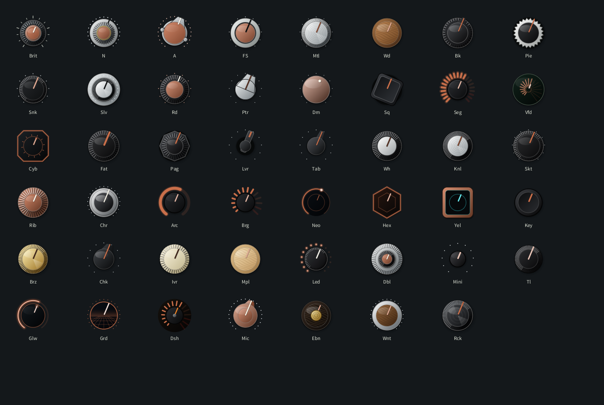
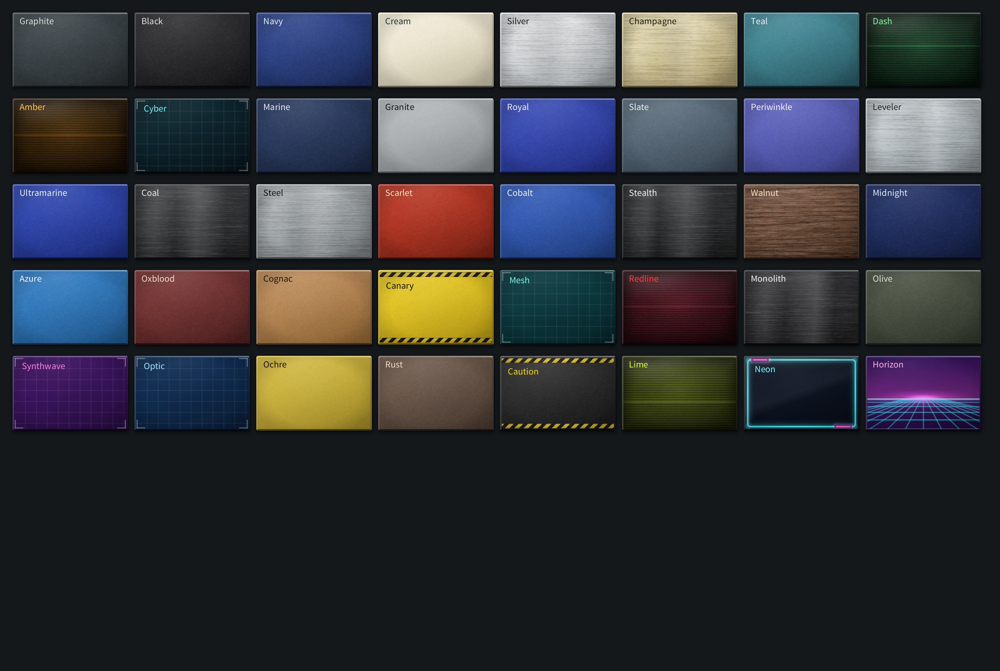
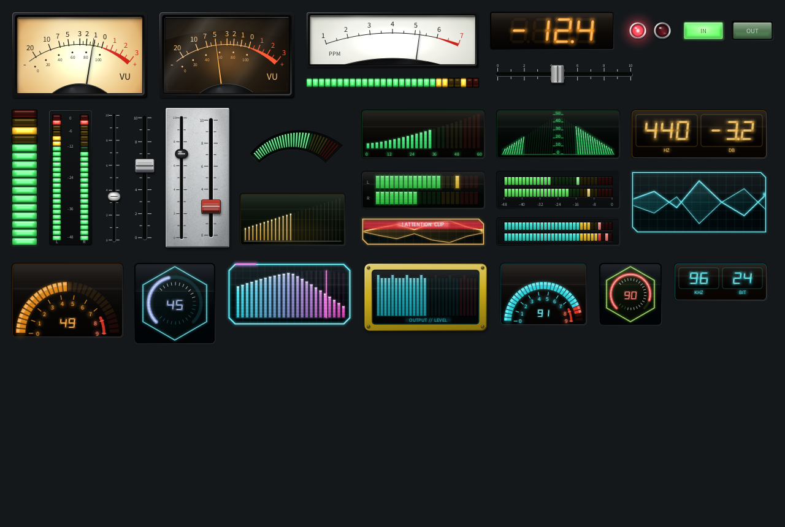
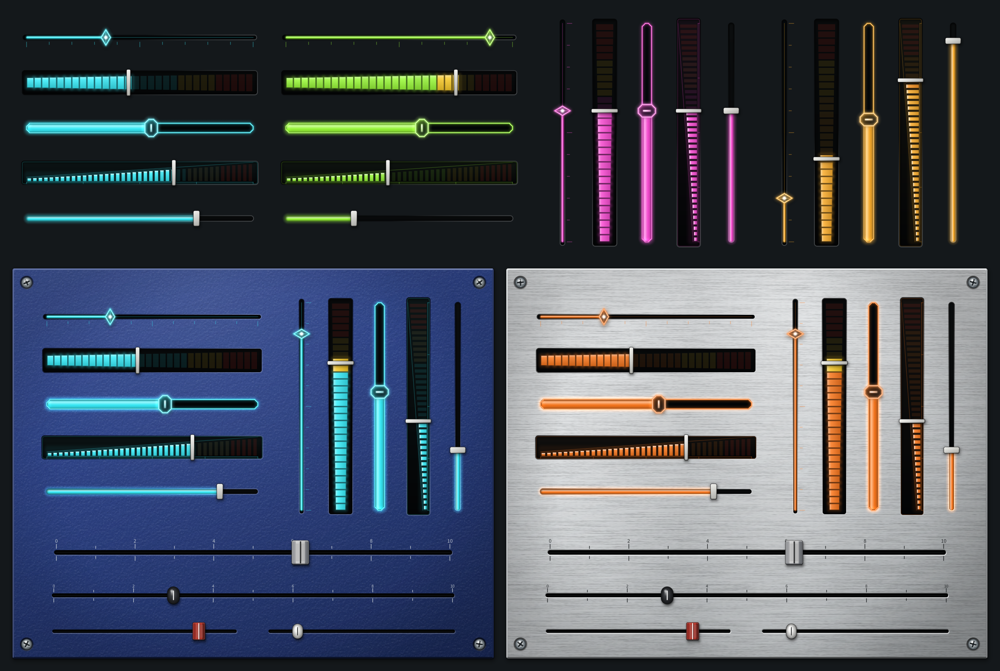
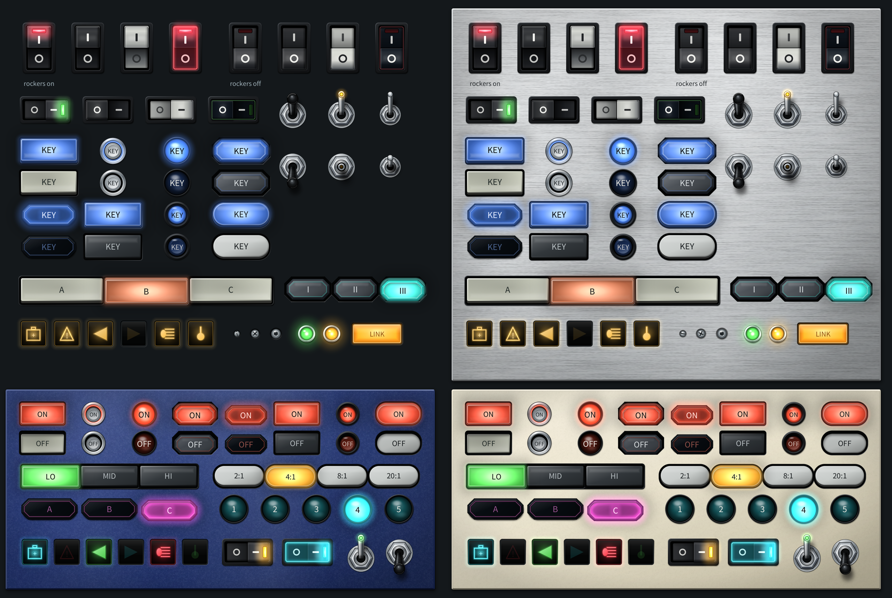
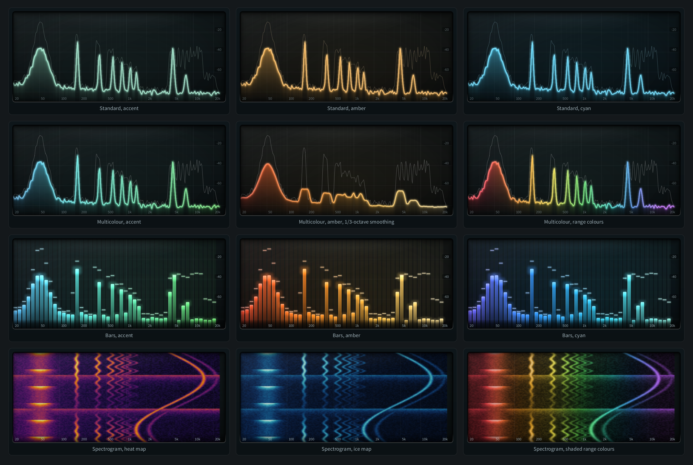

# GoodLookinDri

A Rust toolkit for generated analogue-hardware and retro-futuristic interfaces for audio plugins and tools. It contains no plugin: plugins live in their own repositories and draw with whatever window and plugin format they already use.

GoodLookinDri is the Rust companion to [GoodLookinUI](https://github.com/MistaMin/GoodLookinUI). Both speak the same design files, the same knob and plate names, and the same spectrum and meter behaviour. GoodLookinUI paints with its C++ adapter. GoodLookinDri records the same parts as drawing commands so a Rust host can replay them.

This is an early implementation, not a finished framework.

## Screenshots

The pictures below are the shared catalogue, rendered by the GoodLookinUI gallery. Every shape is generated in code. GoodLookinDri draws that same catalogue into a [`Scene`](src/scene.rs). `gallery::paint_page` lays out the six pages. A pixel diff against these images is still future work.

### 47 knobs


### 40 plates, with surface finishes


### Meters: professional hardware, 80s dash and cyberpunk


### Sliders


### Switches, push buttons, lamps and readouts


### Spectrum analyser looks, smoothing and spectrogram


## What you get

- A versioned CSV design model and critically damped display motion. Files written by GoodLookinUI load here, including the older HardwareUI header and the legacy style names `console`, `metal`, `bakelite` and `ivory`.
- 47 procedural knob classes, each with its own colour, in two families:
  - **Hardware.** Contact shadow, fluted grips, machined caps, wood grain, pointer and lever shapes, digital and neon faces.
  - **Flat.** The legacy 2D vector family. A `flat_` prefix (`flat_Brit`, `flat_Bk`) or `draw::FLAT_KNOBS` selects it.
- 40 plate looks with brushed, wood-grain, scanline, hazard, grid, neon-edge and synth-horizon finishes.
- Meters, lamps, keys and sliders: VU and PPM, LED ladders, 7-segment readouts, icon lamps, oval and console fader caps, 80s-dash faces and cyberpunk faces. Glow is an argument on the retro calls.
- Spectrum analysis on the UI thread: wait-free sample ring, real-input FFT, Hann window calibrated to dBFS, tilt, fall-off, peak hold, log-frequency columns, fractional-octave smoothing, and a spectrogram with a heat map or per-range colours. Standard, Multicolour, Bars and Spectrogram looks.
- Rocker switches (4), toggles (3), push buttons (8) and radio key banks.
- A lock-free stereo level tap and an editable per-parameter look table.
- Printed marks follow the plate: `marks` is `auto`, `light` or `dark`, stored as an optional 11th CSV column. Older 10-column files still load.
- Developer autosave into a folder of your project (for example `Designs/`). Writes are debounced, atomic, quiet when the bytes match, and they keep the file's existing line endings, so `git diff` shows the edit. Settings that are not per-knob go to a key/value `Settings.csv`.
- Inspector state for development builds: style, label, colour wheel, font, position, size, marks, undo, and CSV load. The host paints the widgets. Release builds can leave this module unused and embed the accepted CSV.

The inspector edits controls the host registers. Positions are relative to their parent panel. It does not yet create controls, edit menus, or drag them between panels.

## How a plugin uses it

The audio thread only pushes samples:

```rust
levels.push(&[left, right]);
spectrum_in.push(&[left, right]);
```

The GUI thread animates the display and records paint commands. Parameter changes go straight to your DSP. Motion never delays them.

```rust
motion.step(normalized, dt_seconds, 18.0);
let mut scene = goodlookindri::scene::Scene::new();
goodlookindri::hardware::draw_panel(&mut scene, panel, top, bottom, plate.finish);
goodlookindri::draw::knob(&mut scene, knob_bounds, motion.position, &item, true, dark_marks);
// Replay scene.cmds with your editor's graphics context.
```

`Item.parameter` is your parameter id. `host::value_for` looks it up. `host::map_rect` scales a design into the editor. This crate does not open a window, own mouse routing, or call `set_parameter`.

See the [integration guide](docs/INTEGRATION.md).

## Window shell

`goodlookindri-shell` opens a window and replays a `Scene` with a software rasteriser, for tools that are not plugins. It supports Windows 7 to 11 and macOS 10.6.8 to current. See [docs/SHELL.md](docs/SHELL.md). The core crate above stays standard-library only.

## Dependencies

| Part | Requirements | License |
| --- | --- | --- |
| Design model, spectrum, meters, drawing commands | Rust 2021, standard library only | MIT |
| Tests | `cargo test` | MIT |

No bitmap assets, fonts, icon packs, or GUI frameworks are bundled. The screenshots are documentation of the shared catalogue. A host supplies the window, the typeface, and the plugin format (CLAP, VST3, AU, LV2, AAX, or a standalone tool). See [dependency notes](docs/DEPENDENCIES.md).

## Getting started

```sh
git clone https://github.com/MistaMin/GoodLookinDri.git
cd GoodLookinDri
cargo test
```

Add it to a plugin crate:

```toml
[dependencies]
goodlookindri = { git = "https://github.com/MistaMin/GoodLookinDri" }
```

## Checks

`cargo test` covers CSV round-trips with commas and quotes, rejected geometry, duplicate ids, stable motion, settings and look tables, level-tap peak and power, FFT against a direct DFT, sine calibration in dBFS, tilt, spectrogram history, the default spectrum settings string, and a non-empty command list for every knob style in both families and for each gallery page.

What is still open: a raster backend and a pixel comparison with the gallery images, hit-testing for every control, and DAW audio and automation tests. Those belong to the host plugin as well as to this toolkit.

## Next milestones

See [the implementation plan](docs/IMPLEMENTATION.md).

## Console-style appearance

The first complete appearance built with this family of tools is a vintage-console panel: brown, blue, green and red EQ caps, cream filter knobs, aligned strips, physical choice keys, generated fader caps and an inset response display. The toolkit stays independent of any DSP.

Existing CSV designs with the original HardwareUI header still load. Newly saved designs use the GoodLookinUI header, so a design can move between the C++ toolkit and this one.

## License

GoodLookinDri source code and documentation are released under the [MIT License](LICENSE), copyright 2026 Marcos Deida.
